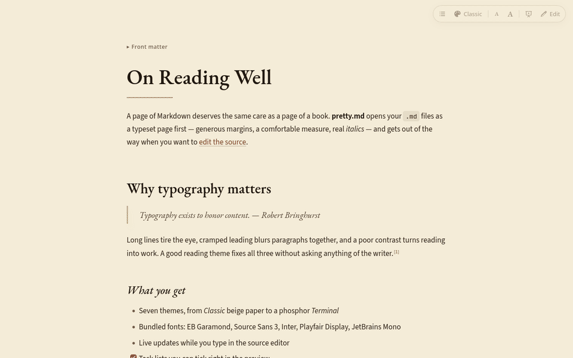
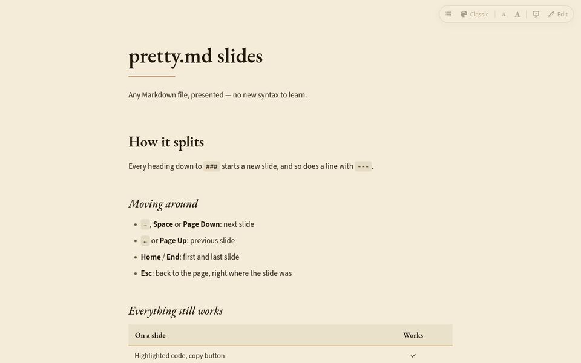

# pretty.md

**Read your Markdown like a book, and present it like a deck.** pretty.md opens `.md` files as a beautifully typeset page — generous margins, a comfortable line length, real serif and sans fonts — puts the source one click away when you want to edit, and turns any of them into slides.

## Why

Agentic coding has turned Markdown into the main thing we read. Claude Code, Codex, Cursor and friends write plans, specs, design notes, `CLAUDE.md` and `AGENTS.md`, READMEs, review reports and changelogs — page after page of it, usually opened as raw source in an editor tab: no margins, 140-character lines, `**` and `|---|` everywhere.

pretty.md is for that reading. It makes the documents your agents (and your colleagues) produce **pleasant to read** — opened as a typeset page by default, with the source one click away — and lets you **present any of them as slides**, so the plan your agent just wrote can go straight on the screen in a meeting, with no new syntax to learn.

## Features

- **Opens pretty by default.** Click a `.md` file and you get the page, not the markup. Diffs and Git views stay as text.
- **Seven reading themes**, switchable from the palette button in the corner (hover a theme to preview it):

  | Theme | Look |
  |---|---|
  | **Classic** | Beige paper, very dark brown ink, EB Garamond headings over a Source Sans body |
  | **Manuscript** | Ivory book page, Garamond throughout, justified and hyphenated |
  | **Paper** | Crisp white with Inter, for technical docs |
  | **Espresso** | The Classic look in the dark: cream ink on roasted brown |
  | **Night** | Deep blue, gold accents, Playfair Display headings |
  | **Terminal** | Monospace everywhere, phosphor green on black |
  | **Editor** | Follows your VS Code colour theme and fonts |

- **Fonts included.** EB Garamond, Source Sans 3, Inter, Playfair Display and JetBrains Mono ship with the extension, so the page looks the same on every machine. Nothing is downloaded.
- **Edit in one click.** Press **Edit** on the page (or `Ctrl+Shift+V` / `Cmd+Shift+V`) to open the source beside it. The preview updates as you type and follows your scrolling. **Double-click any paragraph** to jump to that line.
- **Present it as slides.** Press the play button and the document becomes a deck: every heading down to `###` (you choose the level) and every `---` line starts a new slide. Move with the arrows, the keyboard (`→` `←` `Space` `Home` `End`) or a swipe; `Esc` takes you back to the page, where the slide was. Each slide glides in and its blocks rise one after another, long slides shrink to fit the screen, and they update live while you edit the source beside them.

  

- **Its own sidebar** (the open-book icon in the Activity Bar):
  - **Appearance**: theme thumbnails (hover to preview, click to apply), text size, column width, and a switch for opening `.md` files in pretty.md;
  - **Contents**: the headings of the document you are reading or editing; click one to jump there, in the page and in the source;
  - **Markdown Files**: every Markdown file in the workspace as a folder tree (`node_modules` and friends left out).
- **Reading comforts:** a table of contents that tracks where you are, text size buttons, a toolbar that hides while you scroll, and find (`Ctrl+F`).
- **Everything you write in Markdown:** syntax-highlighted code with a copy button, tables, footnotes, task lists you can tick right on the page, GitHub alerts (`> [!NOTE]`, `> [!WARNING]`…), YAML front matter, relative images and links to other Markdown files.

## Install

- **VS Code:** search for **pretty.md** in the Extensions view, or install it from the [Marketplace](https://marketplace.visualstudio.com/items?itemName=remogrillo.pretty-md).
- **VSCodium and other editors without the Marketplace:** download `pretty-md.vsix` from the [latest release](https://github.com/RemoGrillo/pretty_md/releases/latest), then *Extensions → ⋯ → Install from VSIX…* (or `codium --install-extension pretty-md.vsix`).

## Usage

| To… | Do this |
|---|---|
| Read a file | Just open it |
| Change theme | **Appearance** in the pretty.md sidebar, the palette button in the preview toolbar, or **pretty.md: Select Theme** |
| Edit the source | **Edit** button, `Ctrl+Shift+V` on the page, or double-click a paragraph |
| Go back to the page | Book icon in the editor title bar, or **pretty.md: Open Pretty Preview** |
| Jump to a section | **Contents** in the sidebar, or the list button in the preview toolbar |
| Present as slides | Play button in the editor title or the preview toolbar, **pretty.md: Present as Slides**, or right-click a file → **Present as Slides** |
| Open `.md` files as text by default again | The switch in **Appearance**, or **pretty.md: Toggle Opening Markdown Files in pretty.md by Default** |

You can also right-click a file and choose **Open With… → Text Editor**.

## Settings

| Setting | Default | Description |
|---|---|---|
| `prettyMd.theme` | `classic` | Reading theme |
| `prettyMd.fontSize` | `17` | Base text size in pixels |
| `prettyMd.contentWidth` | `medium` | `narrow`, `medium`, `wide` or `full` |
| `prettyMd.slideLevel` | `3` | In slide mode, headings up to this level start a new slide |
| `prettyMd.editSourceBeside` | `true` | Open the source in a split next to the page |
| `prettyMd.scrollSync` | `true` | Scroll the page along with the source |
| `prettyMd.typographer` | `true` | Curly quotes, dashes, ellipses |
| `prettyMd.breaks` | `false` | Treat single line breaks as ` ` |

## Privacy

pretty.md has no telemetry and makes no network requests. Scripts inside your Markdown never run: the preview has a strict Content Security Policy.

## License

[MIT](LICENSE). Bundled fonts are under the SIL Open Font License 1.1; see [THIRD_PARTY_NOTICES.md](THIRD_PARTY_NOTICES.md).
